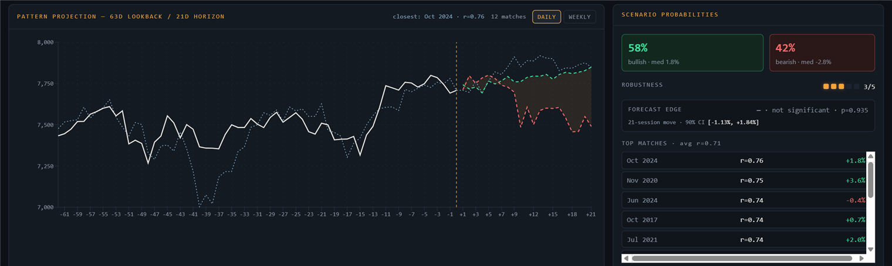
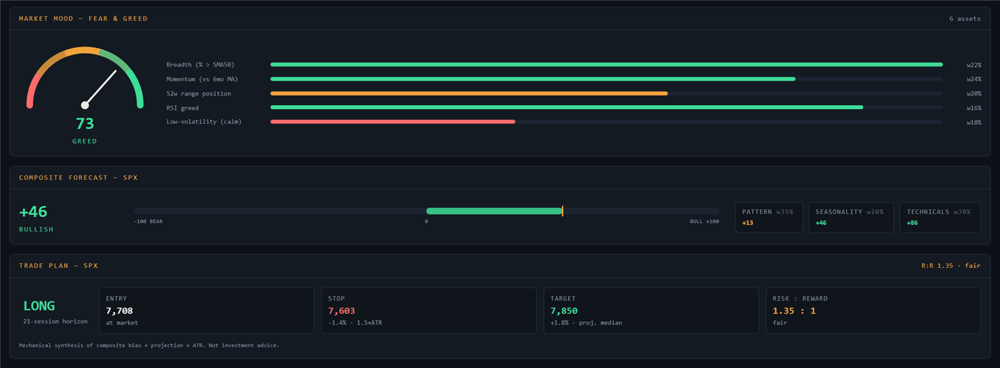

<div align="center">

# EDGEWISE

**A quantitative markets terminal that tells you when its own forecast is just noise.**

Pattern-analog forecasting · Monte Carlo · seasonality · valuation · walk-forward backtesting
· sector rotation · an AI analyst · and a behavioural trading journal — in one dark terminal UI.

[Quick start](#quick-start) · [Features](#features) · [Architecture](#architecture) · [Project structure](#project-structure)

<br>



<sub><i>The forecasting engine on the S&P 500. Solid line: the last 63 sessions. Dotted line: the closest
historical analog (Oct 2024, r=0.76) rescaled to today's price. Green/red: median bull and bear paths from
12 matched analogs — and, on the right, the verdict that this particular setup is
<b>not statistically significant (p=0.935)</b>.</i></sub>

</div>

---

## What this is

A single-page quantitative trading terminal, built
from scratch as an exercise in **quantitative analytics and resilient data engineering**.

Every number on screen is computed locally from real market data — there are no mocked panels.
The forecasting engine finds historical periods that look like *right now*, measures what happened
next, and then runs a **permutation test to check whether that edge is statistically real or could
be produced by picking windows at random.** Most pattern-matching tools skip that last step; it is
the part I care most about.

> **Not investment advice.** This is a data-visualisation and statistics project.

---

## Quick start

Requires [Node.js](https://nodejs.org) 18 or newer.

```bash
git clone https://github.com/combaye/edgewise.git
cd edgewise
npm install
npm run dev
```

Open **http://localhost:5173**.

**No API keys are required.** Prices and 10 years of history are served free via Yahoo Finance,
CoinGecko, and Frankfurter, so the terminal is fully functional on a fresh clone.

<details>
<summary><b>Optional API keys — for fundamentals and the AI analyst</b></summary>

Two panels need credentials. Copy the template and fill in whichever you want:

```bash
cp .env.example .env
```

| Variable | Unlocks | Get one at | Required? |
|---|---|---|---|
| `TWELVEDATA_KEY` | Valuation models, earnings, insider filings | [twelvedata.com](https://twelvedata.com/pricing) (free tier) | No |
| `ANTHROPIC_API_KEY` | The AI Analyst brief and ask-bar | [console.anthropic.com](https://console.anthropic.com/) | No |

Both are read **server-side only** — no `VITE_` prefix, so they are never bundled into the
browser. Without them those two panels show a short setup note and everything else runs normally.

</details>

---

## Features



<sub><i>Top of the dashboard: a fear/greed gauge aggregated across the watchlist, the weighted composite
bias, and a mechanical trade plan derived from that bias plus ATR.</i></sub>

### Forecasting & statistics
- **Pattern projection** — z-scores the last 63 sessions, slides that window across 10 years of
  history, ranks every candidate by Pearson correlation, and keeps the top 12 non-overlapping
  analogs (excluding the recent window to avoid lookahead). Projects day-by-day median bull/bear
  paths, and overlays the single closest analog rescaled to today's price so you can *see* the
  historical episode driving the forecast.
- **Forecast-edge significance** — a permutation test asks whether correlation-selected analogs are
  genuinely more directional than randomly chosen windows. Reports a p-value, an A/B/C grade, and a
  bootstrap 90% confidence interval on the projected move. **When the pattern is noise, it says so.**
- **Monte Carlo** — 2,000 paths via stationary block bootstrap (preserves volatility clustering,
  unlike i.i.d. resampling), rendered as a percentile fan with P(up), VaR₉₅ and CVaR₉₅.
- **Walk-forward backtest** — replays the forecasting engine at every past horizon step using only
  data available at that moment. Reports hit rate, Sharpe, Sortino, profit factor and max drawdown
  net of transaction costs, plus a calibration table of predicted vs. realised probability.
  Runs in a Web Worker so the UI never blocks.

### Market analysis
- **Composite forecast** — weighted ensemble of pattern (35%), technicals (30%), seasonality (20%)
  and value (15%) into one −100…+100 bias gauge.
- **Seasonality** — monthly and day-of-week mean returns and win rates across all available years.
- **Technicals** — RSI, SMA 50/200 and crossover, MACD histogram, Bollinger %B, 52-week range.
- **Overbought/oversold** — composite oscillator heat meter (RSI, Stochastic, Williams %R, %B, CCI).
- **Volatility & regime** — realised vol with its 10-year percentile, Kaufman efficiency ratio,
  ATR, and drawdown stats, classified into trend/range regimes.
- **Sector map** — a Relative Rotation Graph of the 11 SPDR sector ETFs vs. SPY, with an inferred
  economic-cycle phase.
- **Correlation matrix**, **Market Mood** fear/greed gauge, and **COT positioning** from the
  official CFTC public API.

### Fundamentals
- **Fair value** — simplified Graham DCF, Peter Lynch, and an EVA proxy, plus an **Altman Z-Score**
  bankruptcy read (safe / grey / distress).
- **Earnings calendar** with beat rate and surprise history, a **breakeven** signal for companies
  turning profitable after a loss streak, and **insider transactions** with 6-month net sentiment.
- **Congressional trades** — recent US politician stock disclosures.

### Workflow
- **AI Analyst** — Claude reads the entire computed dashboard and streams back an analyst thesis,
  the drivers behind it, and the risks that would flip it. Includes a natural-language ask bar.
- **Screener** — scans a large-cap universe in a background worker and ranks every name by
  composite, pattern bias, seasonality, oscillators and technicals, with sortable columns and
  "top setups / weakest / seasonal tailwind" idea chips.
- **Trading journal** — log trades, then get an equity curve, P&L calendar, discipline streak,
  behavioural-leak detection, per-setup breakdowns, and an AI coaching brief built from *your* stats.
- **Position sizer**, **price alerts**, **persistent watchlist**, a **⌘K command palette**, and
  one-click **PNG export** of the dashboard.

---

## Architecture

The interesting engineering is in four places.

### 1. A resilient multi-provider data proxy

The browser never talks to a data vendor directly. Everything goes through an in-house proxy —
Vite middleware in development, a serverless function in production, sharing one core in `server/`.

```
browser ──▶ /api/td ──▶ server-side cache ──▶ provider chain
                                              ├─ Yahoo Finance   (all asset classes)
                                              ├─ CoinGecko       (crypto fallback)
                                              ├─ Frankfurter/ECB (FX fallback)
                                              └─ Twelve Data     (fundamentals only)
```

Three properties fall out of this design:

- **Keys stay server-side.** No `VITE_` prefix means credentials are never shipped to the client —
  verified against the production bundle.
- **One fetch serves every session.** The server-side cache is shared across all clients and
  survives restarts, cutting upstream calls by orders of magnitude.
- **It degrades instead of dying.** Price and history resolve free-first, so exhausting the Twelve
  Data free tier only pauses the two fundamentals panels. Symbols that vendor gates behind a paid
  plan (e.g. the S&P 500 index) resolve fine through Yahoo.

### 2. Analytics as pure functions

Every engine in `src/lib/` is a pure function: bars in, numbers out — no fetching, no React, no
state. That makes the maths independently testable, runnable in Node, and trivially movable into a
Web Worker. The two heaviest jobs — the walk-forward backtest and the universe screener — run in
real workers so a multi-second computation never freezes the interface.

### 3. Failure isolation

Every panel is wrapped in its own error boundary, so one failing analytic renders a local error
card with a retry instead of blanking the terminal. Network failures, rate limits, and insufficient
history each degrade to a specific, readable message per panel rather than a spinner that never ends.

### 4. Hardened public endpoints

Both server endpoints are reachable by anyone once deployed, so everything they receive is treated
as hostile.

- **`/api/td` — no key exfiltration.** The requested path is checked against an allow-list of the
  eight endpoints the app actually uses, and symbols must match a strict pattern. Independently, the
  one function that attaches the API key refuses any path that isn't a plain `/segment` and verifies
  the final hostname before a request leaves. Without this, a crafted path such as
  `@attacker.example/x` would turn `https://api.twelvedata.com` + path into a request to the
  attacker's host, carrying the key.
- **`/api/ai` — not a free LLM proxy.** Requests are limited to the app's three modes; the payload is
  rebuilt field by field with caps on depth, array length and string length, so a long free-form
  prompt can't be smuggled through; bodies are byte-capped; and calls are rate-limited per client
  and per instance. Upstream error text is never echoed back to the caller.
- **Tested adversarially.** `server/__tests__/security.test.js` fires real attack payloads at both
  handlers with the network stubbed, and asserts the key is never sent to a foreign host. The suite
  was confirmed to fail against the original, unpatched code.

---

## Tests

```bash
npm test
```

Runs the Vitest suite (currently the security regression tests for the public endpoints).

---

## Project structure

```
src/
  components/      26 panels + the journal sub-app (React)
  lib/             34 pure-function modules — the analytics engines
  hooks/           React Query data hooks (quotes, history, fundamentals, journal)
  workers/         backtest + screener Web Workers
server/            provider adapters, routing/fallback, shared cache, AI handler
api/               serverless entry points for production deployment
```

Roughly **9,200 lines** of JavaScript across 95 files.

---

## Tech stack

**React 18** · **Vite** · **Recharts** · **TanStack Query** (with localStorage persistence) ·
**Tailwind** (layout only — colours are custom tokens) · **Web Workers** ·
**Anthropic SDK** (streaming, server-side)

---

## Deployment

The app builds to static assets plus two serverless functions (`api/td.js`, `api/ai.js`). On
Vercel it deploys with no configuration beyond setting `TWELVEDATA_KEY` and `ANTHROPIC_API_KEY`
in the project environment — both optional.

```bash
npm run build     # production build
npm run preview   # serve the build locally
```

> **If you set `ANTHROPIC_API_KEY` on a public deployment, also set a monthly spend limit in the
> Anthropic console.** The built-in rate limits live in each serverless instance's memory, so they
> reset on cold starts and aren't shared across instances — they stop casual abuse, while the
> console limit is the hard backstop. For a strict global limit, back the limiter with a shared
> store such as Upstash Redis.

---

## Notes and limitations

- Free data providers occasionally rate-limit or return thin history for illiquid symbols; panels
  handle this per-symbol rather than failing globally.
- Crypto history from CoinGecko is close-only, which slightly degrades ATR-based calculations.
- Backtest results include transaction costs but not slippage or market impact.
- The forecasting engine is deliberately conservative about claiming an edge — a "not significant"
  reading is a real and common result, not a bug.

---

## License

[MIT](LICENSE)
